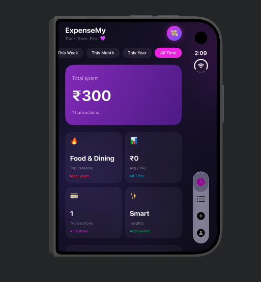
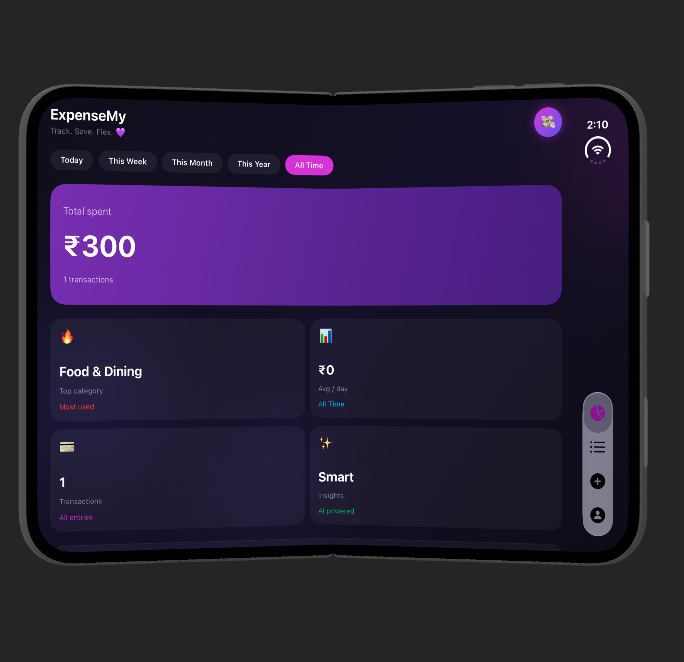
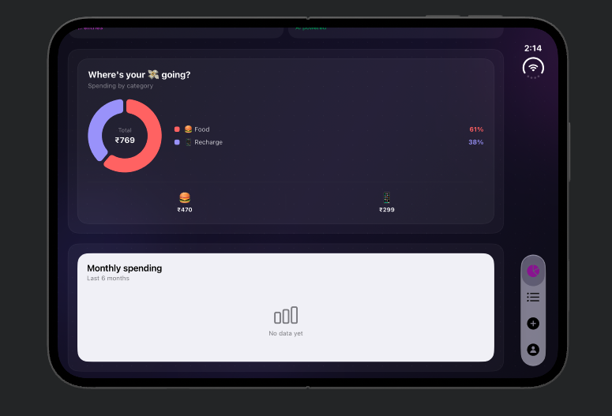
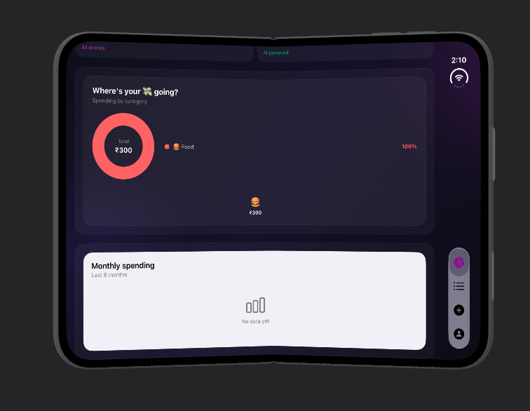
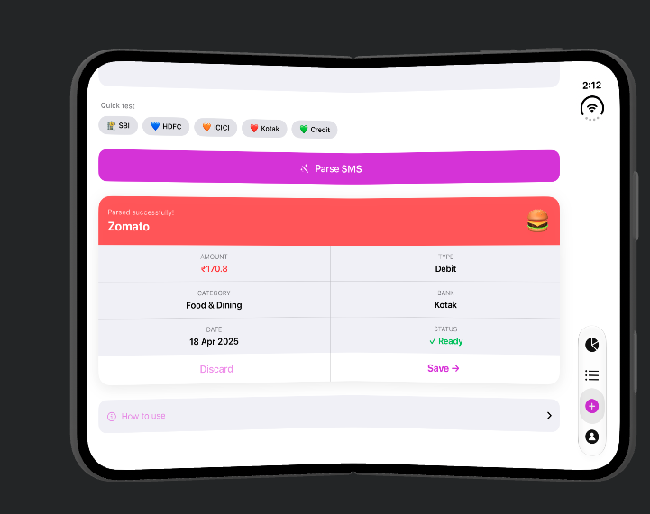
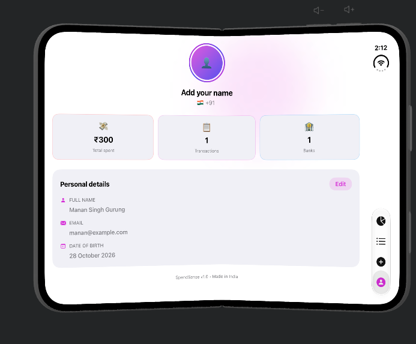
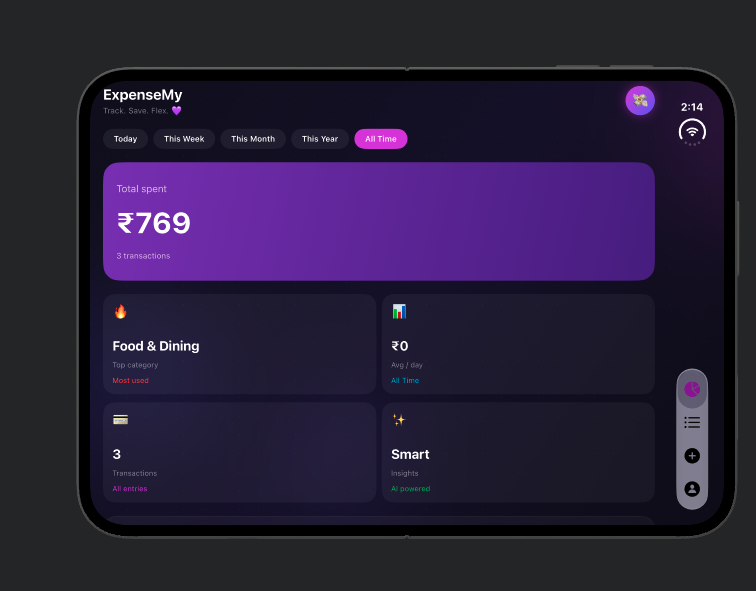

# ExpenseMy 💜

### Track. Save. Flex.

ExpenseMy is an iOS expense-tracking app designed to make tracking
daily spending simple, visual, and convenient.

## ✨ Features

- 📊 **Spending Dashboard** — View total spending and expense summaries.
- 💳 **Transaction Tracking** — Keep track of recorded transactions.
- 📨 **SMS Parsing** — Parse supported bank SMS messages into transaction details.
- 📈 **Spending Analytics** — Visualize expenses by category.
- 🧠 **Smart Insights** — Explore spending patterns.
- 👤 **Personal Profile** — Manage personal details.
- 💾 **Local Data** — Store transaction data using SwiftData.

## 📱 Screenshots

### 1. Dashboard

See total spending, transaction counts, categories, and insights.

  
  

### 2. Spending Analytics

Explore category-wise spending and the monthly spending section.

  
  

### 3. SMS Transaction Parsing

Parse an SMS and review the detected transaction before saving it.

  

### 4. Profile

View personal details and a summary of recorded transactions.

  

### 5. Dashboard — Spending Overview

  

## 🛠️ Tech Stack

- Swift
- SwiftUI
- SwiftData
- Swift Charts
- SMS transaction parsing
- App Groups and Share Extension

## 🚀 Getting Started

1. Clone this repository.
2. Open `ExpenseMy.xcodeproj` in Xcode.
3. Select an iOS simulator or compatible device.
4. Build and run the app.

## 👨‍💻 Author

**Manan Gurung**

---

Made with 💜 using SwiftUI.
